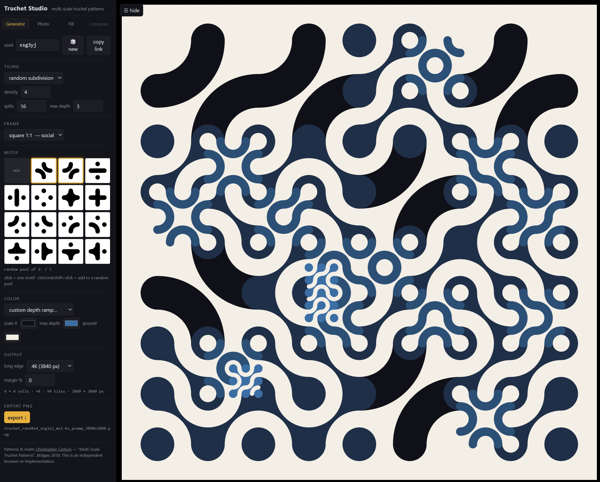

# Truchet Studio

*An artistic exploration of multi-scale Truchet patterns in the browser.*



This is an **experiment, not a library**. It exists because the patterns are
beautiful and because making them behave correctly at every scale turned out to
be an interesting problem. There is no API, no package, no supported interface
beyond the one the page gives you. Take it as a sketchbook you are free to copy,
change and make prints from.

## What it makes

**Pictures in whatever shape and size you ask for.** The output is a pattern
filled into a frame you choose: a phone wallpaper, a desktop wallpaper, an
ultrawide strip, a square post, a portrait image for a feed, or a size you type
yourself. The picture above is one result out of many the same app will give
you.

It is **interactive**. Everything happens in a panel of plain controls beside the
canvas, and every change redraws the picture immediately: how the tiles are
laid, how dense they are, how much they break into smaller tiles, which motifs
are in the mix, which colours the depth passes through, what shape the frame is.
Nothing is buried in a dialog, nothing has to be compiled, and there are no
sliders to squint at - the values go in boxes you can type. Ask for another
pattern and it makes one, so the same settings keep producing results you have
not seen.

It **exports pictures**, not previews. Square, portrait, wide, ultrawide, or a
size of your own; from a modest 1K image up to 4K and beyond, at the width and
height you ask for. What gets saved is the pattern drawn at that size, not an
enlarged screenshot of the canvas.

The word "square" only belongs to the tile, never to the picture. The tile is a
square because that is how the motif's arcs meet its edges; the lattice laid
into your frame is rectangular, and it is laid out *for* that frame. A 21:9
frame at 4K is a lattice of 63 columns by 27 rows - about 4250 tiles - not a
square pattern trimmed into a strip, and nothing is cropped or letterboxed.

**Why it holds together across sizes.** Within one picture some cells stay large,
their neighbours split into four smaller tiles, and some of those split again.
Where a large tile's motif runs off its edge, the smaller tiles beside it carry
the same band at their own size, so the line continues across scales instead of
stopping at a boundary. Tiles at an odd subdivision depth draw the motif
inverted, which is what keeps the whole frame reading as one surface rather than
a mosaic of patches.

## The four tabs

**Generator** — the pattern engine: the controls described above,
applied to a blank canvas.

**Photo** — a picture becomes a pattern. Upload an image; it is sampled, and
each tile is given the motif whose own black-and-white ink fraction is closest
to the tone it covers, then subdivided quadtree-fashion where the image has
detail. It is an approximation made entirely of Carlson's two ideas — multi-scale
subdivision and per-tile tone matching — never a traced outline or a dithered
bitmap. Your image is never written into the share link, so a Photo link reopens
asking for the image again.

**Fill** — a shape becomes a frame for the pattern. Choose a preset outline
(circle, heart, star, letterforms…) or paste your own mask, and the tiling is
built to fill that region, scaled to the frame rather than cropped to it.

**Composer** — planned, not built.

## Filling the frame

The pattern is generated *for* the frame rather than trimmed to fit it, so a
wide desktop wallpaper, a phone background and a square social post each get the
lattice they were meant to have instead of a square pattern cut down to size.
Nothing is cropped and nothing is letterboxed, and the export is the same
lattice you see on screen drawn at the full size you chose.

The saved file is named from what made it — tiling, lattice, seed, motifs and
palette — rather than carrying a watermark over your picture.

Everything you set lives in the URL hash, including which tab you were on, so
"copy link" hands over the pattern exactly as you left it.

## Running it

Open **`dist/truchet.html`** in a browser. It is the whole app in one file, with
every script and style inlined and no external references — it works from a USB
stick, from a local folder, from anywhere.

For the dev layout, open `index.html`, which loads `src/` directly. After
changes, `node build.js` regenerates the single file.

## Verification

Because the geometry has to be right for the bands to cross scale boundaries,
the work was checked against two things: Christopher Carlson's published figures,
and an independent Python model of the same geometry written from the published
description (`dev/port.py`). The automated gates compare the browser's own output
with that model — tile by tile, pixel by pixel — and each exits non-zero on
failure:

```
python dev/_inkqa.py       ink fractions of all 24 tiles
python dev/_tilesqa.py     tile polygons, browser vs model, per pixel
python dev/_appqa.py       the 15 motif previews vs the model
python dev/_fillqa.py      the Fill tab, driven through the real UI
python dev/_photoqa.py     the Photo tab, driven through the real UI
python dev/_ressqa.py      every frame format x every long edge x every tab
```

`HANDOFF.md` is the working log: what was measured, what was wrong, what was
fixed and what was tried and then removed. It is kept because watching a wrong
assumption get found is part of the project.

## Credits and licence

**Pattern design and mathematics: [Christopher Carlson](https://christophercarlson.com/portfolio/multi-scale-truchet-patterns/)**,
*"Multi-Scale Truchet Patterns"*, Bridges 2018. All the interesting ideas here
are his. This is an independent reimplementation written from the published
description of the geometry — no line of his Wolfram Language source was
translated into this engine, and the engine contains none of his code.

**This project's code was written by an AI coding agent.** Qwen 3.8 flash
(model build `qwen3.8-flash-next`) working in the [pi](https://github.com/badlogic/pi-mono) coding-agent
harness, at the direction of **pmousse**, who chose the direction, supplied the
reference images, judged every result and owns the project. Worth stating
plainly: some of the reasoning here was the agent's, some of it was the human's,
and the division is not neat. `HANDOFF.md` records the actual back-and-forth,
including the mistakes.

- **Our code** (`src/`, `dev/`, `build.js`, `index.html`, `dist/`, `docs/`,
  README, HANDOFF, LICENSE, NOTICE): **MIT**, © 2026 pmousse. See `LICENSE`.
  Use it, modify it, sell prints made from it; keep the licence text and the
  attribution.
- **Carlson's own material is not in this repository and is not licensed here.**
  His Wolfram source, notebook and the figures used while checking this work are
  copyrighted by their author and are not ours to redistribute; they are kept in
  the author's local working copy only and are git-ignored.
- `NOTICE` carries the attribution that should travel with any copy, and the app
  states the credit in its own panel.
